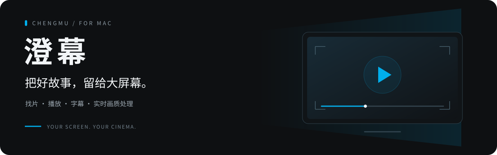
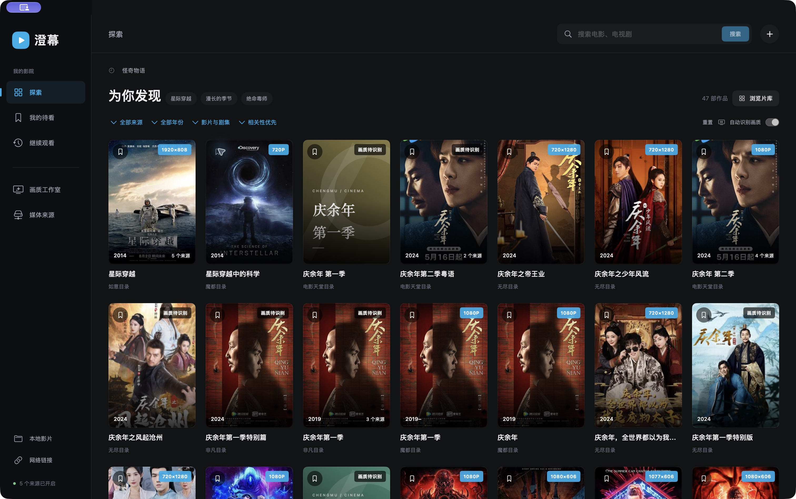
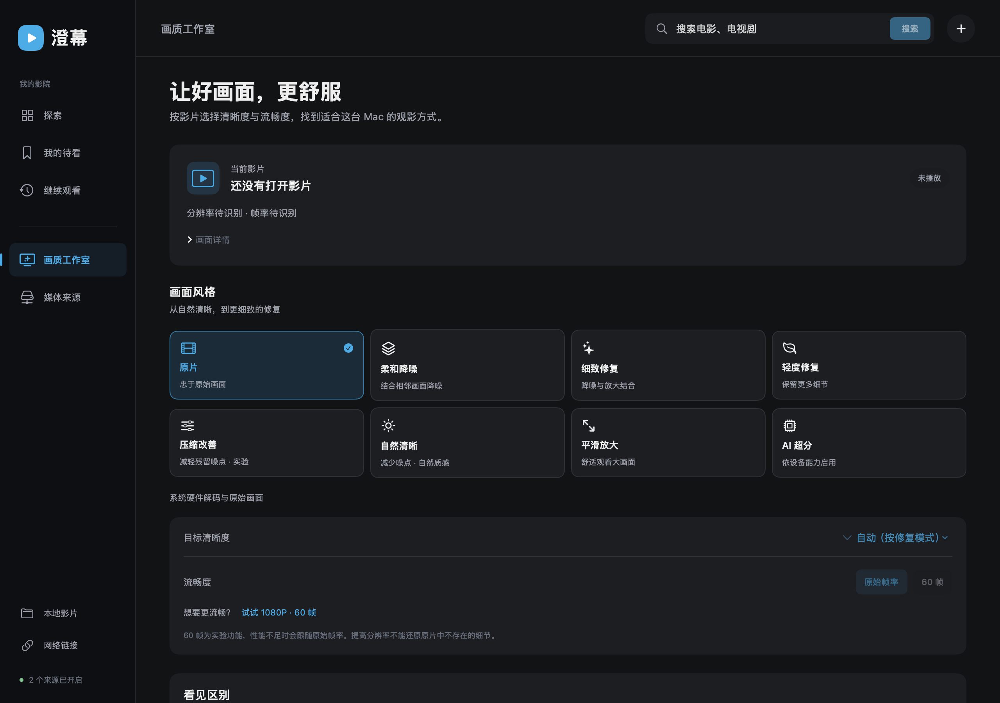
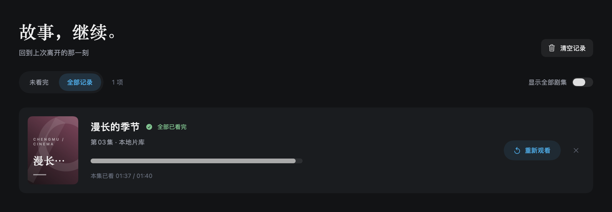

<div align="center">



# 澄幕 · Chengmu

**为 Mac 打造的个人影视播放器**

从发现一部电影，到继续昨晚的那一集。<br>
把多源找片、沉浸播放、字幕与实时画质处理，放进一个原生应用。

[](https://github.com/yangxiaowai/chengmu-player/releases/latest)


**[下载 Mac 版](https://github.com/yangxiaowai/chengmu-player/releases/latest)** · [界面预览](#界面预览) · [功能介绍](#功能介绍) · [快速上手](#快速上手) · [反馈建议](https://github.com/yangxiaowai/chengmu-player/issues)

<sub>A native macOS player for media discovery, immersive playback, subtitles, and on-device picture processing.</sub>

</div>

---

## 让看电影这件事，顺手一点

找片时，希望少翻几页；播放时，希望界面安静；再打开时，希望故事接得上。

澄幕围绕这些日常需求设计。你可以搜索电影与剧集、比较不同来源的画质，也可以打开自己的本地影片或媒体链接。进入播放后，字幕、选集、进度预览和画质设置随手可用；全屏闲置时，控件自动淡出，把画面留给故事。

| 找到想看的 | 安心看下去 | 调成自己喜欢的样子 |
| :--- | :--- | :--- |
| 多源搜索、片名与季数相关性排序、组合筛选、媒体画质标识 | 全屏观影、进度预览、断点续播、选集换源、播放时屏幕常亮 | 字幕样式、本机降噪与缩放、原片对照、目标分辨率与帧率选择 |

## 界面预览

**探索 · 封面、画质、来源，一眼看清**



<table>
  <tr>
    <td width="50%"><strong>画质工作室</strong><br>原片与多种画面模式，清晰度和流畅度分别选择。</td>
    <td width="50%"><strong>继续观看</strong><br>未看完与全部记录分开，想续看或重温都方便。</td>
  </tr>
  <tr>
    <td></td>
    <td></td>
  </tr>
</table>

<sub>探索主图来自 v0.4.1 实际安装版；画质页为 v0.4.0 原生界面渲染，历史页为 v0.4.2 演示数据渲染。展示图用于说明界面，目录内容与可用画质会随来源变化。</sub>

## 功能介绍

### 01 / 从搜索到选集，少一点来回切换

- **多源搜索**：内置 5 个媒体目录，聚合同名同年份作品，在详情中保留不同来源、线路与集数选择。
- **更贴近片名的结果**：优先匹配作品与明确季数；影片与剧集、解说、预告、短剧可独立筛选，也能组合来源、年份与排序。
- **先看画质与延时，再选来源**：卡片自动显示实际读取的分辨率或识别状态，详情比较来源与线路的尺寸、帧率；支持清晰度排序和手动更新。选源卡片与线路同时显示 HTTP 响应毫秒数，播放中可查看已有结果。[查看选源界面](docs/validation/v0.4.3/ui/native-source-response.png)。
- **自己的影片也能看**：打开本地文件，或粘贴 HLS / MP4 媒体链接。兼容的 HTTPS CMS JSON 目录也可自行添加。

媒体参数对应具体来源的某一集，其他集数或 HLS 自适应版本可能不同；读取失败仍可继续尝试播放。目录可检索不等于影片一定可播放。

### 02 / 播放时，让界面退到后面

- **沉浸全屏**：隐藏选集侧栏，闲置时淡出顶部与底部控件及鼠标；暂停、缓冲和操作时恢复显示。
- **直觉操作**：单击画面播放 / 暂停，双击切换全屏；支持连续快进快退、精确时间跳转、倍速与音量控制。
- **进度预览**：鼠标悬停进度条，查看对应位置的缩略图；预览独立取帧，不打断主播放。
- **接着看**：本机保存观看进度、待看与常用播放偏好；自动连播、睡眠定时和播放时屏幕常亮按需设置。
- **换源与重试**：缓冲或失败时有明确提示；可重试当前集，或核对同季同集的其他片源后恢复进度。

### 03 / 画面怎么处理，由你选择

澄幕把**片源参数、目标设置和实际输出**分开呈现。先判断来源，再选择处理方式；原片始终可以随时对照。

| 你想做什么 | 澄幕提供什么 |
| :--- | :--- |
| 保留原始画面 | 原片播放，交给系统原生呈现 |
| 减轻噪点 | 自然降噪、时域降噪，以及轻度 / 常规流式修复 |
| 在大屏上观看 | 平滑缩放、可用时启用 Apple AI 超分；目标支持片源、720p、1080p、1440p、4K 或自动 |
| 比较处理是否合适 | 临时查看原片、同帧分屏，避免仅凭“输出尺寸”判断观感 |
| 试试更流畅的运动 | 支持条件下尝试 1080p 内的 60 fps 插帧，性能不足时回退 |
| 判断这台 Mac 能否负担 | 本机处理性能检测，展示实际耗时和帧预算 |

画质处理在本机随播放进行，无需等待整集导出。时域修复、Apple AI 与插帧需要 **macOS 26+** 及相应运行时能力；效果受片源与硬件影响，4K 输出不等于恢复原生 4K 细节，60 fps 目前为实验目标，尚未证明本机可稳定达到。

**HDR / Dolby Vision 片源优先保留系统原生路径。** 应用区分片源声明、当前轨道与设备能力；普通 SDR、立体声不会被标成杜比视界或全景声。具体适配与验证范围见[画质和视听说明](docs/user-guide.md#杜比与-hdr-的适配方式)。

### 04 / 字幕，调到舒服为止

支持选择片源字幕，或导入 UTF-8 编码的 **SRT / VTT / ASS 文本字幕**。字号、背景、上移位置在本机保存，外挂字幕可调整时间偏移；控制栏出现时，字幕会向上避让。

按 **S** 即可隐藏或恢复字幕，不丢失当前选择和时间偏移。暂停时导入也会立即显示；同片重试保留外挂字幕，新片清除旧文件与偏移。ASS 当前提取对白文本，尚不支持完整排版与动画。

### 05 / 减少干扰，保留字幕

**自动跳过插播广告（实验）**：使用本机 OCR 识别特定推广画面，对确认的广告主段执行跳过；可关闭，也可撤销上一次跳过。字幕继续沿用原视频时间轴。

**画面文字柔化**：手动框选广告区域，并设置字幕保护区，局部柔化而非裁切整个画面。原始文件保持不变。这两项不保证识别所有广告，也无法无痕恢复被广告遮住的背景。

## 下载与安装

### 当前版本：v0.4.5 · build28

| 项目 | 要求 |
| :--- | :--- |
| 平台 | macOS 15 或更新版本 |
| 发行架构 | Apple Silicon（M 系列，arm64） |
| 进阶画质功能 | macOS 26+，并取决于输入格式、系统与硬件能力 |
| 安装包 | ZIP 内含 `澄幕.app`，无需安装 Python、FFmpeg 或其他播放器 |
| 签名状态 | 本地签名，尚未经过 Apple 公证 |

1. 前往 **[Releases 下载页](https://github.com/yangxiaowai/chengmu-player/releases/latest)**，下载 `Chengmu-v0.4.5-macOS-AppleSilicon.zip`。
2. 解压，将 `澄幕.app` 放到希望保留的位置，例如“应用程序”文件夹，再打开应用。
3. 升级前正常退出旧版，再替换应用。已有观看记录与偏好沿用，无需重新建立片库。

首次打开可能出现 macOS 的应用验证提示。当前没有正式发布 Windows、Linux、iOS 或 Intel Mac 安装包。

## 快速上手

| 第一步 | 第二步 | 第三步 |
| :--- | :--- | :--- |
| **找到影片**：在“探索”搜索片名，或从左侧打开本地文件 / 网络链接 | **选择版本**：查看画质标识，在详情里选择来源、线路和集数 | **开始观看**：按 F 全屏，按 S 切换字幕，需要时打开画质设置 |

想留到周末？点击封面或详情中的待看按钮。想接着昨晚看？打开“继续观看”，默认显示尚未看完的作品；看完中间一集后可接着下一集，也可切换全部记录。

### 常用快捷键

| 操作 | 快捷键 |
| :--- | :--- |
| 播放 / 暂停 | `空格` 或 `⌘ P` |
| 快退 / 快进 10 秒 | `←` / `→`，或 `⌥ ⌘ ←` / `⌥ ⌘ →` |
| 音量减 / 加 | `↓` / `↑` |
| 静音 / 恢复 | `M` |
| 全屏 / 退出全屏 | `F`；全屏时也可按 `Esc` 退出 |
| 隐藏 / 恢复字幕 | `S` 或 `⇧ ⌘ S` |
| 跳转到指定时间 | `⌘ J` |
| 上一集 / 下一集 | `⌘ ←` / `⌘ →` |

单键快捷键在播放器获得焦点时生效，输入文字时不会抢走按键。更多操作见[完整使用指南](docs/user-guide.md)。

## 最近更新

**v0.4.5 · 更多来源，更从容地选择**

按已获取的画质和响应信息优先展示五个来源，支持查看更多并继续查找；增加开放影片和开放短视频目录。符合条件的普通网络视频文件优先排除 HTTP 代理播放，失败时回退系统网络。无后缀 HLS 链接在识别后也可使用相应的进度预览路径。

[本版更新说明](docs/releases/v0.4.5.md) · [验证记录](docs/验收记录-v0.4.5.md) · [历史版本](https://github.com/yangxiaowai/chengmu-player/releases)

## 常见问题

<details>
<summary><strong>为什么能搜到影片，却不一定能播放？</strong></summary>

媒体目录、媒体清单和实际视频数据是不同环节。来源可能失效、限流、返回不支持的编码，或受当前网络影响。可以更新画质、换线路、在“媒体来源”检查连接，或使用自己的可访问媒体链接。澄幕不提供官方平台会员账号登录或 DRM 绕过。

</details>

<details>
<summary><strong>画质显示“暂未获取”，还能播放吗？</strong></summary>

可以继续尝试。自动识别有并发与时间限制，失败不会禁用播放；卡片右键可更新画质。读取的是具体来源某一集的参数，不能代表整季所有版本。正式播放时，后台画质识别会暂停，优先保证当前播放。

</details>

<details>
<summary><strong>可以把任何影片变成 4K、60 帧或杜比吗？</strong></summary>

不可以。缩放与降噪不能保证还原已经丢失的细节。60 fps 插帧是有条件的实验功能，本机尚未达到稳定 1080p60，4K60 暂不支持。HDR / Dolby Vision 使用原生呈现；Atmos 声明与轨道信息不等于已验证扬声器听感或杜比认证，也不会把普通片源转换成杜比母版。

</details>

<details>
<summary><strong>需要账户吗？数据放在哪里？</strong></summary>

不需要澄幕账户。观看历史、待看和偏好保存在本机，目前没有云端同步。搜索、海报与媒体播放会向相应第三方来源发起请求；画质处理和广告 OCR 在本机进行，无需 DeepSeek 等云端 API 密钥。

</details>

<details>
<summary><strong>支持所有视频和字幕格式吗？大陆网络能直接用吗？</strong></summary>

当前基于 AVFoundation，HLS、MP4 等能否播放取决于实际封装与编码；尚未集成 libmpv，不能承诺所有 MKV、音频和 ASS 特效。部分来源做过大陆节点与物理接口连接检查，但只能说明当时指定样本可访问，不保证全国、所有来源或整集稳定。详见[使用指南](docs/user-guide.md)。

</details>

## 开发与参与

澄幕使用 **SwiftUI + AVFoundation + Metal / Core Image / VideoToolbox** 构建。界面、播放控制与图像处理均在原生工程中；当前 Swift Package 没有第三方包依赖。

```text
Sources/
├── CinemaApp/       原生界面、播放控制、图像处理与广告识别
└── CinemaCore/      媒体目录、清单、字幕、记录与偏好
Tests/               核心测试与应用模型回归
scripts/             构建、媒体检查与性能验证
docs/                使用指南、调研、发行说明与验证记录
```

从源码开始：

```bash
git clone https://github.com/yangxiaowai/chengmu-player.git
cd chengmu-player
# 按项目约定，调用 Python 的开发脚本在 searchformoney 环境执行。
conda run -n searchformoney --no-capture-output bash scripts/swift.sh test
conda run -n searchformoney --no-capture-output bash scripts/build-app.sh release
```

开发需要 macOS 15+、Swift 工具链与已准备好的 conda `searchformoney` 环境；部分媒体检查另需 FFmpeg。普通用户直接下载发行包即可。构建、工具链兼容处理与诊断说明见[开发文档](docs/development.md)。

欢迎通过 [Issues](https://github.com/yangxiaowai/chengmu-player/issues) 提交问题与想法。播放问题请尽量附上应用版本、macOS / 芯片型号、来源与集数、错误提示及复现步骤；涉及链接时请去除个人凭证。改进方向包括字幕时间轴、播放队列、画中画和更多兼容性工作，均尚未作为已实现功能发布。

### 文档与参考

- [完整使用指南](docs/user-guide.md)：详细操作、画质模式、网络连接与故障处理。
- [开发与验证](docs/development.md)：构建方式、历史验证范围和工程入口。
- [播放器对标](docs/research/player-benchmark-2026-10-26.md) / [社区需求调研](docs/research/player-social-feedback-2026-10-26.md)：功能取舍与公开来源。
- [画质修复研究](docs/research/restoration-papers-2026-09-28.md)：论文、开源方案与本机评估。

感谢 [IINA](https://github.com/iina/iina)、[mpv](https://github.com/mpv-player/mpv)、[Swiftfin](https://github.com/jellyfin/Swiftfin)、[Stremio](https://github.com/Stremio/stremio-bugs) 等项目提供的公开文档与体验参考。澄幕没有直接打包这些项目的播放器二进制或模型权重。

### 授权说明

本仓库目前尚未附带项目级许可证；源码公开不等于已授予任意复用或再分发许可。第三方媒体、海报、名称与引用资料的权利归其各自权利人，媒体使用需具有相应授权。

---

<div align="center">

**澄幕 · 把好故事，留给大屏幕。**

[下载体验](https://github.com/yangxiaowai/chengmu-player/releases/latest) · [报告问题](https://github.com/yangxiaowai/chengmu-player/issues) · [查看源码](https://github.com/yangxiaowai/chengmu-player)

<sub>如果澄幕让你的观影更顺手，欢迎 Star，或留下下一次改进的线索。</sub>

</div>
