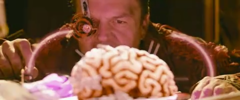

# v0.3.9 播放体验、稳定性和轻度修复

2026-10-26。参考 [mpv 连续定位队列](https://github.com/mpv-player/mpv/blob/baa3e11d42cb7978da634a8a6a3a55fe074d01be/player/playloop.c)、[IINA 定位策略](https://github.com/iina/iina/blob/96f605f6d8c4a3ed7d5d0afac644d8681f766757/iina/PlayerCore.swift) 完成三项改进，方法与边界见[研究记录](research/playback-polish-2026-10-26.md)。

## 实际变化

- 连续快进/快退即时更新累计目标，按首次输入起算的80ms固定窗口合并下发。长按期间仍会执行；绝对定位、换片、关闭或广告撤销会取消旧的延迟目标。待提交的相对目标参与片尾/广告的忙碌判断，避免旧片尾通知抢先切集。
- 修复用户暂停后收到传输中断通知会重建并自动播放的问题。暂停后只显示错误并等待明确重试；播放中的首次自动恢复预算沿用。
- 新增“轻度流式修复”，也可在流式修复的“修复强度”中切换轻度/常规。轻度使用0.5时域强度，常规为0.75；其他放大与颜色路径相同。切换档位重建时域历史，原片比较保留原始输入，HDR继续原生呈现。

## 全帧画质对照

对一段 Tears of Steel 四秒片段的三种退化分别比较全部96帧及95个相邻对。使用两个独立生产管线，输入为同一个原始CV帧和PTS；输出/参考使用相同RGB10A2及浮点读回，源尺寸480×200，不触发AI或最终放大。没有筛选正收益帧。

| 退化 | 轻度相对常规 ΔPSNR dB | 时间导数RMSE变化（码值） | PSNR更好的帧 |
| --- | ---: | ---: | ---: |
| 压缩 | +0.017508 | −0.023708 | 75/96 |
| 轻噪 | +0.023876 | −0.040466 | 69/96 |
| 重噪压缩 | +0.043853 | −0.070560 | 67/96 |

PSNR高、时间误差低为好；收益很小，且并非每帧都改善。这是一部影片的三种退化，不能称三部影片泛化验证。[既有强度扫参](validation/v0.3.5/strength-sweep.md)还有相反例子：未压缩强噪合成源的0.5强度不如0.75。故新档为可选，不统一替换既有选择，也不宣称真实4K细节恢复、显著减少拖影或稳定60fps。

[完整数据](validation/v0.3.9/gentle-film.json)及[复现源码](validation/v0.3.9/gentle-film.swift)。运行`bash scripts/validate-gentle-restoration-film.sh`，需要已有`.build/restoration-lab`四份本地夹具；来源、生成方法与CC BY3.0署名见[影片素材记录](research/film-restoration-validation-2026-09-28.md)。

## 回归结果

- 核心162项/20套件通过，含新选择的保存与重载。
- 旧代码的相对点击重置、暂停后中断两项先失败；修复后已有及新增播放检查21/21通过。覆盖连续输入、长按中实际定位、暂停、显式定位覆盖、换源取消和真实EOF竞态。传输通知部分为注入回调，不称真实广域网断流。
- 系统屏幕常亮19/19通过，停止和对象释放后无本项目遗留保活。
- 流式像素/历史/尺寸/HDR门禁/字幕保护57/57通过。轻度与常规切换的历史重建有直接验证。
- 真实AVPlayer 1080p/24fps局部合成文件播放31/31通过。轻度档输出3840×2160；约3.120秒媒体时间完成75帧，采样处理均值19.91ms。不是物理显示FPS、网络长片、音画同步或持续性能保证。
- 独立只读代码审查未发现可确认P1/P2，未把审查当成运行测试。

[播放检查](validation/v0.3.9/playback-final.json)、[系统保活](validation/v0.3.9/display-sleep.json)、[流式管线](validation/v0.3.9/streaming-pipeline.json)、[实际播放](validation/v0.3.9/restoration-playback.json)。

## 安装与发布

版本0.3.9/build21已安装到`dist/澄幕.app`；v0.3.8/build20归档到`dist/历史版本/澄幕-v0.3.8-build20.app`，未强制停止用户播放器。安装包的签名、CRC、解压、可执行文件一致性及版本核验见[发布清单](validation/v0.3.9/release-manifest.json)。应用采用本地签名，尚未Apple公证。本轮没有完成原生可见界面、扬声器、长时间屏幕和整集观看验收。

## 同帧查看

轻噪第24帧，差异细微；8-bit展示图不作为10-bit显示证明。署名 **(CC) Blender Foundation | mango.blender.org**，CC BY3.0。

常规：

轻度：

